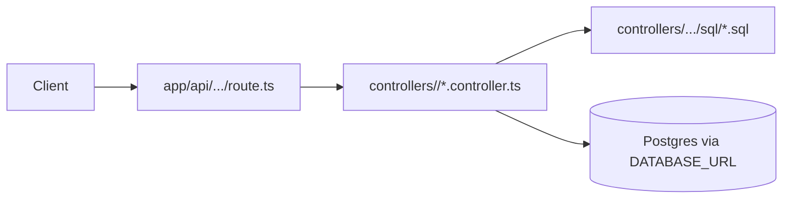

# Web app architecture

## Request flow



## Controller example

```
src/controllers/todos/
  todos.controller.ts
  sql/
    list-by-user.sql
    insert.sql
```

```typescript
// todos.controller.ts
import path from "node:path";
import { executeSqlFile } from "@/lib/db/execute-sql";

const sqlDir = path.join(process.cwd(), "src/controllers/todos/sql");

export async function listTodosByUser(userId: string) {
  return executeSqlFile<{ id: string; title: string }>(
    path.join(sqlDir, "list-by-user.sql"),
    [userId],
  );
}
```

```sql
-- list-by-user.sql
select id, title
from public.todos
where user_id = $1
order by created_at desc;
```

```typescript
// src/app/api/todos/route.ts — service layer
import { createClient } from "@/lib/supabase/server";
import { listTodosByUser } from "@/controllers/todos/todos.controller";

export async function GET() {
  const supabase = await createClient();
  const { data: { user }, error } = await supabase.auth.getUser();
  if (error || !user) return new Response("Unauthorized", { status: 401 });

  const todos = await listTodosByUser(user.id);
  return Response.json({ todos });
}
```

## Module barrels

`src/modules/todos/index.ts`:

```typescript
export * from "./widgets";
export * from "./entries";
export * from "./hooks";
export * from "./contexts";
export * from "./utils";
```

Each subfolder has its own `index.ts` exporting public members only.

## Shared vs module-local

| Location | Use when |
| --- | --- |
| `src/components/` | UI reused by **multiple** modules |
| `src/modules/<x>/entries/` | UI used only inside module `<x>` or its widgets |
| `src/hooks/`, `src/utils/` | Cross-cutting non-UI logic |

## Migration policy

| Allowed | Not allowed |
| --- | --- |
| Edit `supabase/schemas/*.sql`, then `supabase db diff -f name` | Manual SQL files in `migrations/` without CLI |
| `supabase migration new name` then edit generated file | Dashboard schema changes without pull/diff |
| `supabase db push` to remote | Applying DDL from app code or MCP without migration file |

## Version endpoint

Build injects SHA via `next.config.ts` reading `VERCEL_GIT_COMMIT_SHA`. Route returns raw text body, not JSON.
